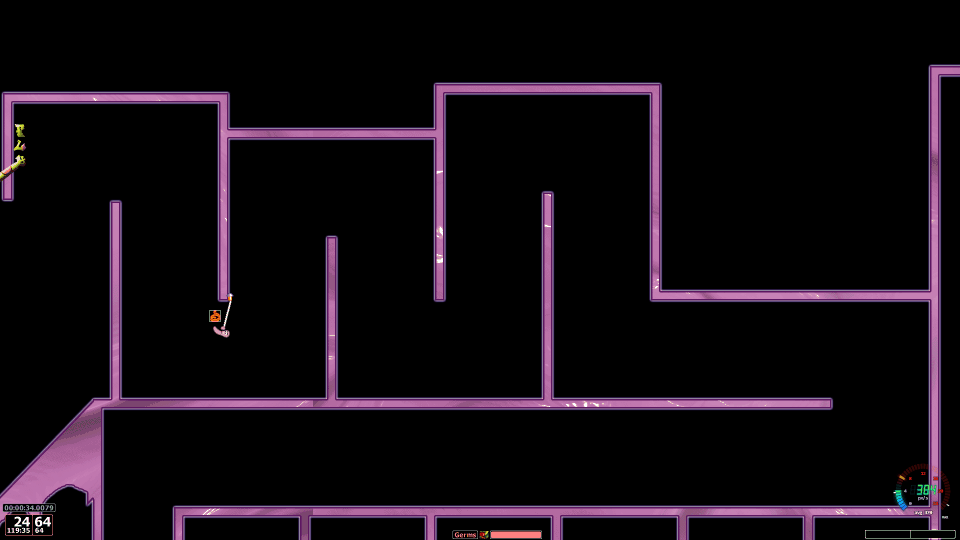
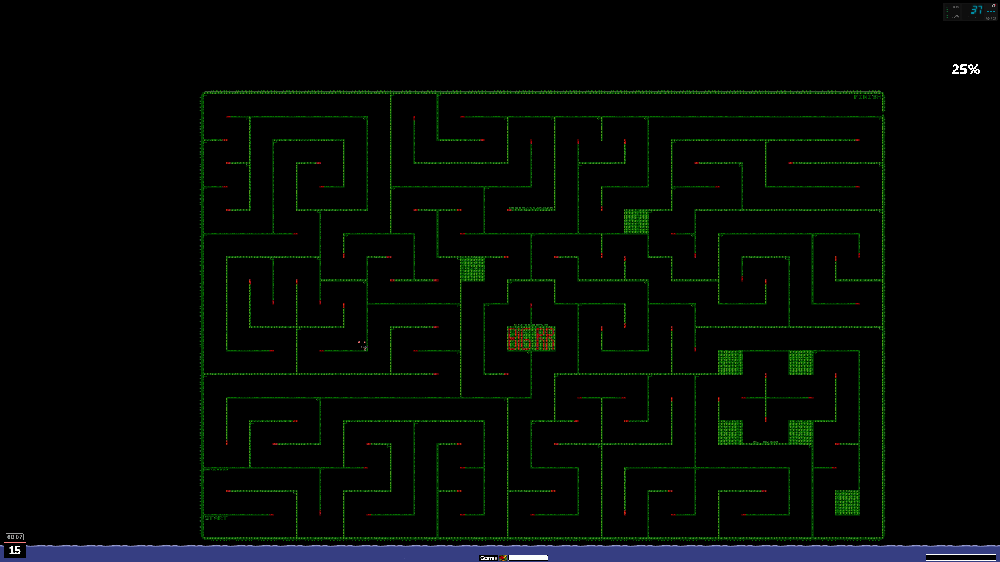
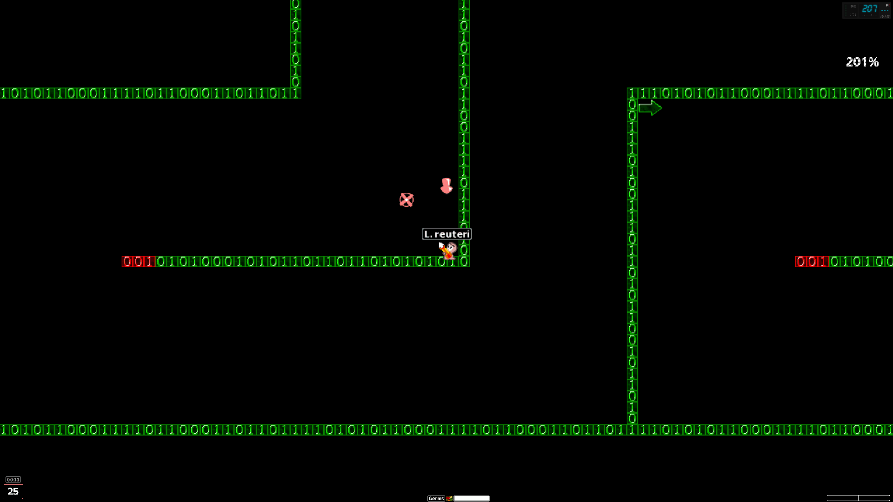
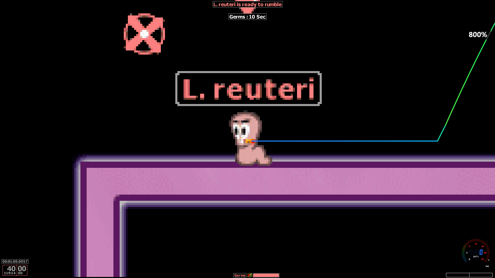

# wkMapZoom

Zoom the map in and out in **Worms Armageddon 3.8.1**: hold **Ctrl** and turn the **mouse wheel** (or use
**numpad + / −**). From **25%** (four times the map each way) to **800%**. An **auto zoom** and a **speed zoom** can
change the zoom on their own.

Only the map zooms. The team bars, turn timer, wind, messages, chat, Esc menu and weapon menu stay their normal
size, and a small number (for example `150%`) shows the zoom while it changes.

> **Version 5 is a beta, and it needs [wkDirect3D](https://github.com/GermsWorms/wkDirect3D).** wkMapZoom now only
> decides the zoom; the zoomed picture is drawn by wkDirect3D on the graphics card, 15 to 30 times faster than
> wkMapZoom 4 drew it on the CPU. Without wkDirect3D (0.4 or newer), or with WA on another renderer than
> Direct3D 9 (shader), the map stays at 100%.
>
> **What moved and what is gone:**
> - The **speedometer** and the **movement line** are their own module now:
>   [wkSpeedometer](https://github.com/GermsWorms/wkSpeedometer). Install it next to this one if you want them.
> - Gone from wkMapZoom: its own drawing, the true-colour picture, full-colour PNG / JPEG maps, and everything it
>   added to WA's Esc menu (the Resolution list, the Fullscreen / Windowed switch, "Map zoom options"). Settings are
>   in `wkMapZoom.ini`, and can be changed in the game with [wkModMenu](https://github.com/GermsWorms/wkModMenu)
>   (5.1: every setting, the keys too, applied at once); Ctrl + A still switches the auto zoom.
> - **The last version with all of that is 4.3 beta 2.** It needs no other module and works on every renderer. Its
>   files are in [`release/` at 4.3 beta 2](https://github.com/GermsWorms/wkMapZoom/tree/f2ee621/release) (the last
>   stable one, 4.2, [here](https://github.com/GermsWorms/wkMapZoom/tree/cc9b734/release)).
>
> If something goes wrong, please [open an issue](https://github.com/GermsWorms/wkMapZoom/issues) with the logs (see
> Notes; the first lines say "wkMapZoom 5.1 beta").



*A big jump on a rope race map: the auto zoom eases out to 38% as the worm heads into the open and goes back to 100%
once it has landed (the number top right is the zoom). The clip was made with 4.3; the speedometer and the coloured
line in it are wkSpeedometer's now.*

## What it does

- **Zoom** with Ctrl + wheel or the numpad, smoothly. 100% and your default zoom are stops on the way through.
- **Auto zoom** (Ctrl + A, or `AutoZoom=1`): the map zooms on its own to fit the space around your worm. Where it opens
  up it zooms out, already as you head into the open, and where it is tight (a time trial map) it zooms in. In an
  ordinary map it stays at your zoom. It looks at where the walls actually are (thin 1-2 px walls too; blown-up holes
  count as open, a girder you put down counts as a wall), changes slowly, never zooms out past where the whole level
  fits the screen, and never moves the camera. The wheel still works: your zoom is the base the auto zoom works from.
  Falling fast (1000 px/s down) it zooms out until the ground below is on screen.
- **Speed zoom** (`SpeedZoom=1`): past a speed (800 px/s) the map zooms out, more the faster you go: x0.7 for every
  500 px/s over.
- **Default zoom** (`DefaultZoom=`): the zoom each game starts at; Ctrl + middle click and numpad * go back to it.
- **Camera.** Zoomed in, the camera keeps your worm within the part of the map you can see. Zoomed out it stays where
  it is at 100%, so near the level's edges it isn't pulled toward the middle (the area past the edge shows).
- **Smooth picture.** Each screen pixel is the average of the map pixels it covers, in full colour, so zoomed-out walls
  and edges stay visible and smooth (`Filter=nearest` picks single pixels instead).

| 25% | 50% |
|---|---|
|  |  |
| **100%** | **200%** |
|  |  |
| **800%** | |
|  | |

The same moment at each zoom: the HUD (timer, team bar, wind, messages) and the zoom number stay the same size, while
the map, the worm and its name zoom. (Pictures from 4.3: the dial bottom right and the coloured line are
wkSpeedometer's now.)

## How fast

Frames a second on one desktop PC, a large open map at full detail, vsync off:

| | wkMapZoom 4.3 (draws on the CPU) | wkMapZoom 5 + wkDirect3D |
|---|---|---|
| 1920x1080 at 35% | 57 to 60 | 1440 |
| 2560x1440 at 35% | 39 to 42 | 1180 |
| 1920x1080 at 25% | | 1310 |
| 2560x1440 at 25% | | 900 |
| 3840x2160 at 50% | | 870 |
| 3840x2160 at 25% | | 460 |

4.3 used nearly four CPU cores for its numbers; 5 uses one. Zoomed out, the graphics card draws the map at full size
first (at 25% that is sixteen times the screen), so a weak graphics card will be slower than this, and wkDirect3D
says in its log how big a map it could make. If it cannot make the biggest one, the zoom simply goes less far out.

## Install

1. Install [wkDirect3D](https://github.com/GermsWorms/wkDirect3D) (0.4 or newer): put `wkDirect3D.dll` in your Worms
   Armageddon folder, next to `WA.exe`.
2. Download `wkMapZoom.dll` (and, if you want to change the settings, `wkMapZoom.ini`) from [`release/`](release/) and
   put them in the same folder (Steam: `...\steamapps\common\Worms Armageddon`; GOG: usually
   `C:\Program Files (x86)\GOG Galaxy\Games\Worms Armageddon` or `C:\GOG Games\Worms Armageddon`). WA must be 3.8.1
   (the version is shown at the bottom of WA's main menu).
3. In WA: **Options > Advanced >** tick **Load WormKit modules** and set **Graphics API** to **Direct3D 9 (shader)**.
4. Start a game, hold Ctrl and scroll.

| | |
|---|---|
| **Ctrl + mouse wheel** | zoom in / out |
| **Numpad + / −** | zoom in / out |
| **Ctrl + middle click**, **numpad \*** | back to the default zoom (100% unless you change it) |
| **Ctrl + A** | auto zoom on / off |

The keys can be changed (5.1): `ZoomModifier`, `ZoomInKey`, `ZoomOutKey`, `ZoomResetKey` and `AutoZoomKey` in
`wkMapZoom.ini`, or in the game with [wkModMenu](https://github.com/GermsWorms/wkModMenu): click the key, press the
new one.

Uninstall: delete `wkMapZoom.dll`.

## Notes

- **WA 3.8.1 only, Steam or GOG.** The module checks `WA.exe` (Steam's file, or any other whose game code is 3.8.1's
  byte for byte, as GOG's is) and does nothing on any other version; the log says which it found.
- **No wkDirect3D, no zoom.** When you try to zoom, the zoom number's place says "Zoom needs wkDirect3D". While
  wkDirect3D is not drawing (WA's Export Video, another renderer), the map is shown at 100%.
- **Only your own screen changes.** No game state is touched, so online games and replays stay in sync, and other
  players don't need the module.
- **Zooming out shows you more of the map than other players see.** Say so before using it in league or competitive
  games, where it may count as an unfair advantage.
- Zoomed in, the camera follows your worm within the part of the map you can see; at 100% and below it follows as
  WA always does.
- In real-time play (wkRealTime), where several worms have the turn at once, there is no auto zoom or speed zoom.
- WA's own screenshots show the zoomed picture, in WA's 256 colours. Videos made with WA's Export Video are not
  zoomed.
- Zoomed far out, the deep water reaches the screen's edges (WA draws it only some way past the level's sides).
- Don't run it together with another zoom module (wkZoom, wkVista, WormForge's zoom): they all take over WA's map
  drawing (wkMapZoom refuses to start when it finds another one's hooks). Keep one zoom module in the WA folder at a
  time, and one copy of wkMapZoom (renamed copies included).
- Once WA has loaded it, the module stays loaded until WA exits. A new `wkMapZoom.dll` takes effect at WA's next start.
- Logs: `%LOCALAPPDATA%\wkMapZoom\wkMapZoom.log` and `%LOCALAPPDATA%\wkDirect3D\wkDirect3D.log` (send both along with
  WA's `ERRORLOG.TXT` if WA crashes).

## Settings (`wkMapZoom.ini`, all optional)

| Key | Default | |
|---|---|---|
| `MaxOut` | `4` | how far out: 4 = 25% (up to 8 = 12.5%, if the graphics card can make a map that big) |
| `MaxIn` | `8` | how far in: 8 = 800% |
| `Step` | `1.15` | zoom per wheel notch or numpad press |
| `Smooth` | `1` | glide to the new zoom (0 = jump) |
| `Filter` | `smooth` | `smooth`: each screen pixel is the average of the map pixels it covers; `nearest`: plain pixel picking |
| `Indicator` | `zooming` | the zoom number: `zooming` (shown while zooming, then fades), `always` (stays while not at the default zoom), `off` |
| `IndicatorPlace` | `top-right` | or `top-left`, `top`, `bottom-right`, `bottom-left`, `bottom` |
| `ZoomModifier` | `ctrl` | the key held with the wheel (and the middle click): `ctrl`, `alt` or `shift` |
| `ZoomInKey`, `ZoomOutKey`, `ZoomResetKey` | `Numpad +`, `Numpad -`, `Numpad *` | keys that zoom in, out, and go back to the default zoom. A key is written as `A`, `Ctrl+A`, `Alt+F6`, `Shift+PageUp`, `Numpad 5`, `Space`, `Key 220` (a virtual-key number) or `none` |
| `AutoZoomKey` | `Ctrl+A` | the key that switches the auto zoom |
| `NumpadKeys` | `1` | an older switch: 0 = the three zoom keys are none unless named above |
| `DefaultZoom` | `1` | the zoom each game starts at, and that Ctrl + middle click and numpad \* go back to (0.7 = 70%; `70%` works too) |
| `AutoZoom` | `0` | the auto zoom on (Ctrl + A switches it, and saves it here) |
| `AutoZoomMin` | `0.35` | the furthest the auto zoom (and the speed zoom) goes out, as a share of your own zoom (0.35 = 35% at 100%; 1 = never out) |
| `AutoZoomMax` | `1.5` | the furthest the auto zoom goes in (1.5 = 150%; 1 = never in) |
| `AutoZoomFallSpeed` | `1000` | the auto zoom keeps the ground below in view only while the worm falls at least this fast (px/s down; 0 = always, above 1600 = never) |
| `SpeedZoom` | `0` | the speed zoom: past a speed the map zooms out, more the faster your worm goes (on its own, or on top of the auto zoom; never further out than `AutoZoomMin`) |
| `SpeedZoomFrom` | `800` | the speed it starts at, in pixels a second |
| `SpeedZoomStrength` | `0.7` | the zoom times this for every 500 px/s over the start speed (0.7 from 800: x0.7 at 1300 px/s, x0.49 at 1800) |

A `wkMapZoom.ini` from 4.3 still works: the keys for what moved or is gone (`Speedometer`, `TurnLine...`,
`TrueColour`, `ColourMaps`, `MapTheme`, `EscMenu`) are ignored, and the log says so.

## How it works

Each frame WA queues everything it draws and then draws the queue back to front. Queue entries of kinds 1, 4 and 7
are placed on the screen (the HUD); every other kind goes through the camera (the map: sky, land, water, worms,
weapons, names). While zoomed, wkMapZoom tells WA's display that it is as big as the area the zoomed view needs, and
has WA draw the map entries into a frame that wkDirect3D hands out for it. So WA's own code works out and draws
everything that is to be seen, at WA's own scale, and wkDirect3D draws it on the graphics card exactly as it draws an
ordinary frame. Then wkDirect3D puts that map on the screen at the zoom, each screen pixel the average of the map
pixels it covers, the display gets its own size back, and WA draws the HUD over it as usual.

Zoomed in, WA's camera clamp is given the size the zoomed view sees, so the camera reaches the level's edges, and its
camera follow the size of what you see, so it keeps up with the worm; zoomed out both are left as WA has them at
100%. The auto zoom casts 16 rays, a pixel at a time, from the turn's worm and from where it is heading (its speed
times 0.5 to 2 seconds) through the land, several times a second. Each ray's end wants the zoom that puts it 80% of
the way to the screen's edge in its direction; the 8 most open directions, averaged, say how open it is there: open
zooms out, ordinary stays at 100%, tight zooms in. While your worm falls fast, the ray straight down comes first.
The zoom then eases there, slowly, and only after a clear change. The speed zoom multiplies that by the strength once
for every 500 px/s your worm goes over its start speed (the speed held for a moment, so a swing's slow top doesn't
pump the zoom).

Hooks (WA 3.8.1, checked by the SHA-256 of `WA.exe`, or of its code section with its sections where 3.8.1 has them,
and the original bytes at each hook point): `00533DC0` GameRender, `00542350` RenderDrawingQueue, `00542F10`
ClampCameraToBounds, the camera follow `00542F70` at its two calls (`00554636`, `0055A4B8`), `00557310` a team task's
message handler and `004FCDF0` an object's physics step (whose turn it is and where its worm is: both only look), and
a `WH_GETMESSAGE` hook on WA's thread for the wheel and the keys. None of WA's drawing functions is hooked any more.

For other modules: `wkMapZoom_View` (exported) gives the zoom and the camera of the frame being drawn, so that a
module that draws on the map (wkSpeedometer's line) knows where a map point is on the screen. `wkModSettings` and
`wkModSettingsChanged` (exported) tell wkModMenu what the settings are and re-read the ini after a change.

## Building

Needs a 32-bit MinGW gcc (for example `C:\MinGW\bin\gcc.exe`) and PowerShell:

```powershell
.\build.ps1                 # runs tests\*.c, then builds wkMapZoom.dll
.\install.ps1               # copies it into the Steam or GOG WA folder (-Game <folder> for another one)
.\install.ps1 -Remove
```

The tests: the zoom arithmetic, the zoom number's picture and the WA.exe check.

## Other zoom modules for W:A

- [wkVista](https://github.com/ropahektic/wkVista) by ropahektic: zoom in (1x to 4x) with the HUD at normal size,
  full-colour maps, true-colour output and the Esc menu resolution switch.
- [wkZoom](https://www.tus-wa.com/files/file-3430) by Sycotropic (TUS, August 2026): smooth camera zoom on the mouse
  wheel plus a separately adjustable HUD scale (Ctrl + wheel), and `/zoom` and `/hud` chat commands. Its zoom works
  within the resolution the game starts at.
- [WormForge](https://github.com/EdLud/WormForge) by EdLud: a Lua modding API whose zoom (up to 4x) builds on wkVista's.

What wkMapZoom adds: zooming **out** past the game's own resolution (down to 25%, without changing WA's resolution),
averaging so thin walls stay visible when zoomed out, the auto zoom and the speed zoom, a camera that keeps up with
the worm when zoomed in, and an on-screen zoom number. What it doesn't do: the HUD keeps its normal size (wkZoom lets
you scale it).

## Credits and licence

- [wkVista](https://github.com/ropahektic/wkVista) (MIT, © 2026 ropahektic): the split of WA's drawing queue into
  screen and camera entries, and reading the land from WA's tiles, are wkVista's. (Up to 4.3, wkMapZoom's own drawing,
  true colour, full-colour maps and Esc menu items were ported from it too.)
- [MinHook](https://github.com/TsudaKageyu/minhook) (BSD 2-clause), in `third_party/minhook`.
- wkMapZoom is MIT licensed: see [LICENSE](LICENSE), and [THIRD_PARTY_NOTICES.md](THIRD_PARTY_NOTICES.md) for the
  notices above.
