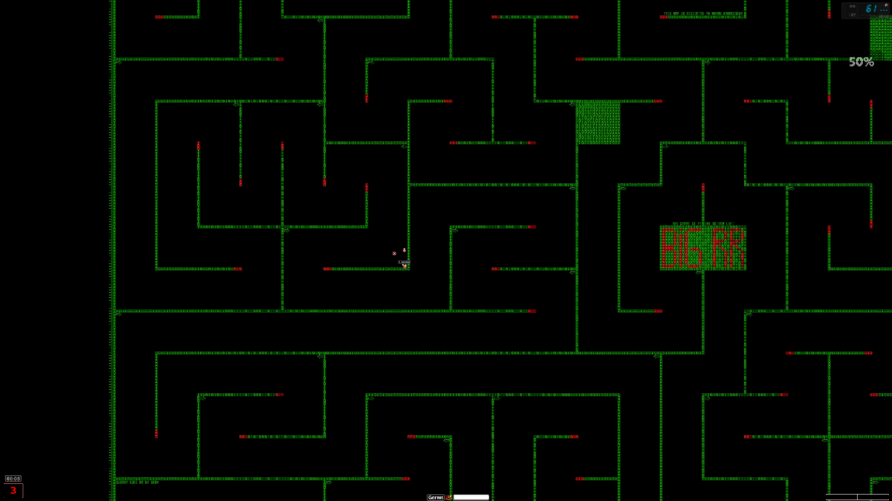

# wkMapZoom

Zoom the map in and out in **Worms Armageddon 3.8.1**: hold **Ctrl** and turn the **mouse wheel** (or use
**numpad + / −**). From **25%** (four times the map each way) to **800%**.

Only the map zooms. The team bars, turn timer, wind, messages, chat, Esc menu and weapon menu stay their normal
size, and a small number (for example `150%`) shows the zoom while you change it.


*The auto zoom on a big rope race map: it eases out as the worm heads into the open and back in where it gets tight
(the number top right is the zoom), and at the turn's start the red line shows where the worm went last turn.*

Also in the module:

- **True colour.** The zoomed map is averaged in full RGB and shown as it is (with WA's renderer on one of its
  Direct3D 9 options), so zoomed-out walls and edges are smooth instead of rounded to WA's 256 colours.
- **Full-colour maps.** Put a PNG (with transparency for the sky) or a JPEG in `User\SavedLevels` and play it: WA gets
  a 64-colour copy it can load, and you see the map's own colours wherever the land hasn't been blown up.
- **Resolution in the Esc menu.** WA's Esc menu gets a Resolution list (your monitor's modes) and a Fullscreen /
  Windowed switch, applied at once without restarting WA.
- **Options in the Esc menu.** "Map zoom options" in WA's Esc menu opens the module's options: auto zoom on / off, how
  far it may zoom out and in, the red line, and the zoom number. Click an option to change it; it is saved in
  `wkMapZoom.ini` at once.
- **Movement line.** When your turn starts, a red line shows where the worm you are playing has been: its last turn
  bright, fading in towards where it stopped (so you can see which way you were going), everything else dimmer (its
  earlier turns, and being knocked about in other players' turns, so the line always ends at the worm). It goes as soon
  as you move, or with "stays" it stays all turn. It follows the worm itself, so teleports (and the cursor while you
  aim them) are not drawn.
- **Auto zoom** (Ctrl + A, the Esc menu, or `AutoZoom=1`): the map zooms on its own to fit the space around your worm.
  Where it opens up it zooms out, already as you head into the open, and where it is tight (a time trial map) it zooms
  in. In an ordinary map it stays at your zoom. It looks at where the walls actually are (thin 1-2 px walls too; blown-up
  holes count as open), changes slowly, never zooms out past where the whole level fits the screen, and never moves the
  camera. The wheel still works: your zoom is the base the auto zoom works from.
- **Zoomed-in camera.** Zoomed in, the camera keeps your worm within the part of the map you can see.

| 25% | 50% |
|---|---|
|  |  |
| **100%** | **200%** |
|  |  |
| **800%** | |
|  | |

The same race map at each zoom: the HUD at the bottom (timer, team bar, wind) and the zoom number stay the same size,
while the map, the worm and its name zoom.

## Install

1. Download `wkMapZoom.dll` (and, if you want to change the settings, `wkMapZoom.ini`) from
   [`release/`](release/) and put them in your Worms Armageddon folder, next to `WA.exe` (Steam: `...\steamapps\common\Worms
   Armageddon`; GOG: usually `C:\Program Files (x86)\GOG Galaxy\Games\Worms Armageddon` or `C:\GOG Games\Worms Armageddon`).
   WA must be 3.8.1 (the version is shown at the bottom of WA's main menu).
2. In WA: **Options > Advanced >** tick **Load WormKit modules**.
3. Start a game, hold Ctrl and scroll.

| | |
|---|---|
| **Ctrl + mouse wheel** | zoom in / out |
| **Numpad + / −** | zoom in / out |
| **Ctrl + middle click**, **numpad \*** | back to 100% |
| **Ctrl + A** | auto zoom on / off |
| **Esc** | WA's menu, now with Resolution, Display and Map zoom options |

Uninstall: delete `wkMapZoom.dll`.

## Notes

- **WA 3.8.1 only, Steam or GOG.** The module checks `WA.exe` (Steam's file, or any other whose game code is 3.8.1's
  byte for byte, as GOG's is) and does nothing on any other version; the log says which it found.
- **Only your own screen changes.** No game state is touched, so online games and replays stay in sync, and other
  players don't need the module. (A full-colour map you host reaches them as WA's 64-colour copy.)
- **Zooming out shows you more of the map than other players see.** Say so before using it in league or competitive
  games, where it may count as an unfair advantage.
- Zoomed in, the camera follows your worm within the part of the map you can see; at 100% and below it follows as
  WA always does.
- The movement line is per worm: each of a team's worms has its own, shown at that worm's turns. It is kept for the
  whole game and starts again with the next game. In real-time play (wkRealTime) there is none.
- The movement line is drawn only on your own screen, like everything else here: it shows where each worm has been,
  which everyone watching the game saw happen.
- True colour needs WA's renderer set to one of its Direct3D 9 options; on the others the map is shown in WA's own 256
  colours (still averaged).
- Choosing a resolution in the Esc menu saves it as WA's own setting, so the next game starts with it.
- Don't run it together with another zoom module (wkZoom, wkVista, WormForge's zoom): they all take over WA's map
  drawing (wkMapZoom refuses to start when it finds another one's hooks). Keep one zoom module in the WA folder at a time,
  and one copy of wkMapZoom (renamed copies included).
- Once WA has loaded it, the module stays loaded until WA exits, so a module that unloads or reloads WormKit modules
  can't pull it out from under WA's code. A new `wkMapZoom.dll` takes effect at WA's next start.
- Log: `%LOCALAPPDATA%\wkMapZoom\wkMapZoom.log` (it names the module's file and where it was loaded; send it along with
  WA's `ERRORLOG.TXT` if WA crashes).

## Settings (`wkMapZoom.ini`, all optional)

| Key | Default | |
|---|---|---|
| `MaxOut` | `4` | how far out: 4 = 25% (up to 8 = 12.5%) |
| `MaxIn` | `8` | how far in: 8 = 800% |
| `Step` | `1.15` | zoom per wheel notch or numpad press |
| `Smooth` | `1` | glide to the new zoom (0 = jump) |
| `Filter` | `smooth` | `smooth`: each screen pixel is the average of the map pixels it covers, so thin walls stay visible zoomed out and pixels stay even zoomed in; `nearest`: plain pixel picking |
| `Indicator` | `zooming` | the zoom number: `zooming` (shown while zooming, then fades), `always` (stays while not at 100%), `off` |
| `IndicatorPlace` | `top-right` | or `top-left`, `top`, `bottom-right`, `bottom-left`, `bottom` |
| `NumpadKeys` | `1` | numpad + / − / \* zoom (0 = left to WA) |
| `AutoZoom` | `0` | the auto zoom on (Ctrl + A and the Esc menu switch it, and save it here) |
| `AutoZoomMin` | `0.35` | the furthest the auto zoom goes out (0.35 = 35%; 1 = never out) |
| `AutoZoomMax` | `1.5` | the furthest the auto zoom goes in (1.5 = 150%; 1 = never in) |
| `TurnLine` | `all` | the movement line at your turn's start: `all` (the whole game, its last turn bright), `last` (its last turn), `off` |
| `TurnLineKeep` | `0` | 1 = the movement line stays all turn ("stays" in the Esc menu); 0 = it goes once you move |
| `TrueColour` | `1` | true-colour output on Direct3D 9 (0 = WA's 256 colours) |
| `ColourMaps` | `1` | full-colour PNG / JPEG maps in `User\SavedLevels` |
| `MapTheme` | `Forest` | the WA theme full-colour maps get (the soil behind craters, the backdrop) |
| `EscMenu` | `1` | Resolution, Display and Map zoom options in WA's Esc menu |

## How it works

Each frame WA queues everything it draws and then draws the queue back to front. Queue entries of kinds 1, 4 and 7
are placed on the screen (the HUD); every other kind goes through the camera (the map: sky, land, water, worms,
weapons, names). While zoomed, wkMapZoom tells WA's display that it is as big as the area the zoomed view needs, so
WA's own code works out everything that is to be drawn there. Each drawing call WA then makes for the map (its bitmap
blit, rectangle fills, sprite blits, pixels and lines) is drawn by wkMapZoom straight onto the screen at the zoom, each
screen pixel the average of the map pixels it covers. The land is drawn from shrunk copies (1/2 and 1/4 size) that are
kept up to date as the land is blown up, so zoomed out the land costs about what it costs at 100%; the drawing is
shared out across the CPU's cores. The map ends up as an RGB picture: it goes into WA's 8-bit frame as the nearest
palette colours, WA draws the HUD on top as usual, and on Direct3D 9 the frame is shown in true colour (the map's
pixels as averaged, the HUD's as WA drew them).

WA's camera clamp is given the size the zoomed view sees, so the camera reaches the level's edges, and zoomed in its
camera follow is given the size of what you see, so it keeps up with the worm. The movement line follows the current
worm of the team whose turn it is (WA's team tasks, and the worms themselves through their physics step), every 2 pixels it moves, and is
drawn into the map's picture so it zooms with the map. The auto zoom casts 16 rays, a pixel at a time, from the turn's
worm and from where it is heading (its speed times 0.5 to 2 seconds) through the land several times a second. Each
ray's end wants the zoom that puts it 80% of the way to the screen's edge in its direction; the 8 most open directions,
averaged, say how open it is there: open zooms out, ordinary stays at 100%, tight zooms in. The zoom then eases there,
slowly, and only after a clear change. The zoom number is drawn into WA's frame in WA's own palette.

Hooks (WA 3.8.1, checked by the SHA-256 of `WA.exe`, or of its code section with its sections where 3.8.1 has them,
and the original bytes at each hook point):
`00533DC0` GameRender, `00542350` RenderDrawingQueue, `0056A700` BlitBitmapClipped, `0056B810` the display's fill,
`004F6910` BlitSpriteRect, `004F9180` / `004F5E40` pixels, `004F9110` vertical line, `004F5D50` grid fill,
`00542F10` ClampCameraToBounds, `00542F70` the camera follow, `0059CB30` / `0059CDE0` the Direct3D 9 backends' "show
frame", `005356D3` / `00540810` the Esc menu, `00557310` a team task's message handler and `004FCDF0` an object's
physics step (the movement line: both only look), WA's `CreateFileA` / `CreateFileW` imports (full-colour maps), and a
`WH_GETMESSAGE` hook on WA's thread for the wheel and numpad. No Direct3D function is hooked (the Steam overlay patches
those), only WA's own code.

## Building

Needs a 32-bit MinGW gcc (for example `C:\MinGW\bin\gcc.exe`) and PowerShell:

```powershell
.\build.ps1                 # runs tests\*.c, then builds wkMapZoom.dll
.\install.ps1               # copies it into the Steam or GOG WA folder (-Game <folder> for another one)
.\install.ps1 -Remove
```

The tests: the zoom arithmetic, the readout, the drawing (`raster_test`: every kind of drawing call at zooms from 12.5%
to 800% against a plain draw-then-average reference, and the land's shrunk copies following a blown-up land) and the
full-colour maps (`colourmap_test`: a PNG and a JPEG opened the way WA opens maps, the copy WA gets taken apart and
matched back to the original).

## Other zoom modules for W:A

- [wkVista](https://github.com/ropahektic/wkVista) by ropahektic: zoom in (1x to 4x) with the HUD at normal size,
  full-colour maps, true-colour output and the Esc menu resolution switch. wkMapZoom's drawing, true colour,
  full-colour maps and Esc menu items are ported from it (see Credits).
- [wkZoom](https://www.tus-wa.com/files/file-3430) by Sycotropic (TUS, August 2026): smooth camera zoom on the mouse
  wheel plus a separately adjustable HUD scale (Ctrl + wheel), and `/zoom` and `/hud` chat commands. Its zoom works
  within the resolution the game starts at.
- [WormForge](https://github.com/EdLud/WormForge) by EdLud: a Lua modding API whose zoom (up to 4x) builds on wkVista's.

What wkMapZoom adds: zooming **out** past the game's own resolution (down to 25%, without changing WA's resolution),
averaging so thin walls stay visible when zoomed out, land drawn from shrunk copies so zooming out stays fast, a camera
that keeps up with the worm when zoomed in, the movement line, and an on-screen zoom number. What it doesn't do: the
HUD keeps its normal size (wkZoom lets you scale it).

## Credits and licence

- [wkVista](https://github.com/ropahektic/wkVista) (MIT, © 2026 ropahektic): wkMapZoom's drawing operations (what each
  of WA's drawing calls does to a pixel), its true-colour output through WA's Direct3D 9 backends, its full-colour maps
  and its Esc menu Resolution / Display items are ported from wkVista's Rust to C and changed; the split of WA's drawing
  queue into screen and camera entries is wkVista's too.
- [wkRGBA](https://github.com/rUNaW4y/wkRGBA) (rUNaW4y) first loaded full-colour maps by handing WA a converted copy.
- [MinHook](https://github.com/TsudaKageyu/minhook) (BSD 2-clause), in `third_party/minhook`.
- wkMapZoom is MIT licensed: see [LICENSE](LICENSE), and [THIRD_PARTY_NOTICES.md](THIRD_PARTY_NOTICES.md) for the
  notices above.
