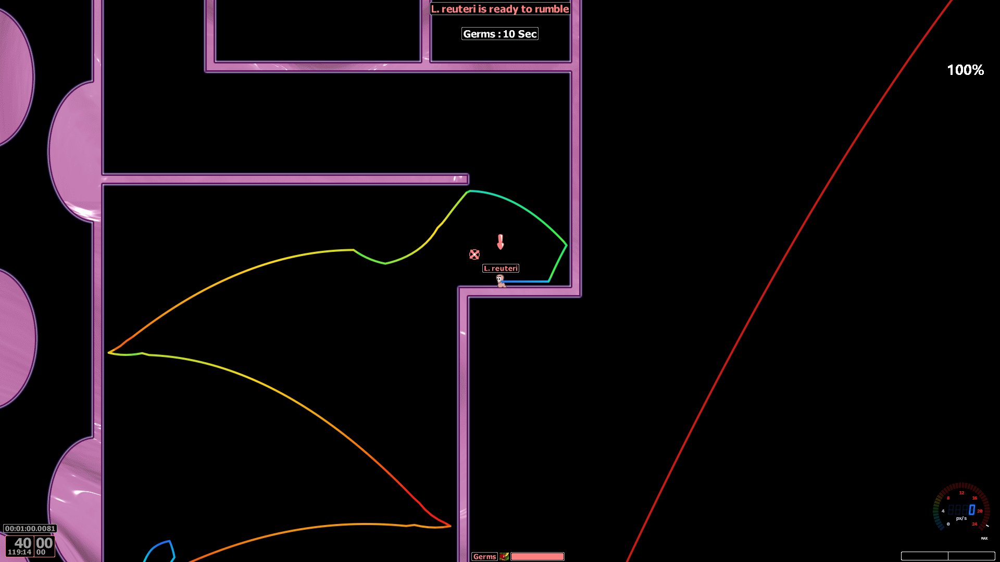

# wkMapZoom

Zoom the map in and out in **Worms Armageddon 3.8.1**: hold **Ctrl** and turn the **mouse wheel** (or use
**numpad + / −**). From **25%** (four times the map each way) to **800%**. An **auto zoom** and a **speed zoom** can
change the zoom on their own.

Only the map zooms. The team bars, turn timer, wind, messages, chat, Esc menu and weapon menu stay their normal
size, and a small number (for example `150%`) shows the zoom while it changes.

It is a WormKit module: one file, `wkMapZoom.dll`. It has the graphics card draw the game's picture instead of the
CPU. That is what makes the zoom fast, and the game itself draws faster too.

> **Version 6 is a beta.** It has been tested on one PC, in a window, on replays. If something goes wrong, please
> [open an issue](https://github.com/GermsWorms/wkMapZoom/issues) with the log (see Notes).


*A big jump on a rope race map: the auto zoom eases out to 38% as the worm heads into the open and goes back to 100%
once it has landed. The number top right is the zoom.*

## What it does

- **Zoom** with Ctrl + wheel or the numpad, smoothly. 100% and your default zoom are stops on the way through.
- **Auto zoom** (Ctrl + A, or `AutoZoom=1`): the map zooms on its own to fit the space around your worm. Where it opens
  up it zooms out, already as you head into the open, and where it is tight (a time trial map) it zooms in. In an
  ordinary map it stays at your zoom. It looks at where the walls actually are (thin 1-2 px walls too; blown-up holes
  count as open, a girder you put down counts as a wall), changes slowly, never zooms out past where the whole level
  fits the screen, and never moves the camera. The wheel still works: your zoom is the base the auto zoom works from.
  Falling fast (1000 px/s down) it zooms out until the ground below is on screen.
- **Speed zoom** (`SpeedZoom=1`): past a speed (800 px/s) the map zooms out, more the faster you go: x0.7 for every
  500 px/s over.
- **Default zoom** (`DefaultZoom=`): the zoom each game starts at; Ctrl + middle click and numpad * go back to it.
- **Camera.** Zoomed in, the camera keeps your worm within the part of the map you can see. Zoomed out it stays where
  it is at 100%, so near the level's edges it isn't pulled toward the middle (the area past the edge shows).
- **Smooth picture.** Each screen pixel is the average of the map pixels it covers, in full colour, so zoomed-out walls
  and edges stay visible and smooth (`Filter=nearest` picks single pixels instead).
- **A faster game.** At 100% zoom too, the graphics card draws the picture: the same picture as WA's, pixel for pixel,
  in a quarter of the time or less.

| 25% | 50% |
|---|---|
|  |  |
| **100%** | **200%** |
|  |  |
| **800%** | |
|  | |

The same moment at each zoom: the HUD (timer, team bar, wind, messages) and the zoom number stay the same size, while
the map, the worm and its name zoom.

## How fast

Frames a second on one desktop PC, WA 3.8.1 on Direct3D 9 (shader), in a window, full detail, vsync off:

| At 100% zoom | WA 3.8.1 alone | with wkMapZoom |
|---|---|---|
| 1920x1080 | 470 | 2070 to 2140 |
| 1920x1080, a match full of explosions | 350 | 2520 |
| 2560x1440 | 310 to 340 | 1950 |
| 3840x2160 | 210 | 1730 |

| Zoomed out (a large open map) | with wkMapZoom |
|---|---|
| 1920x1080 at 35% | 1410 to 1460 |
| 1920x1080 at 35%, on 4 CPU threads | 1520 |
| 2560x1440 at 35% | 1220 |
| 1920x1080 at 25% | 1340 |
| 2560x1440 at 25% | 900 |
| 3840x2160 at 50% | 920 |
| 3840x2160 at 25% | 470 |

Your numbers will differ with your PC and the map. With vsync on, the frame rate stays your monitor's and WA uses
less of your CPU instead. Zoomed out, the graphics card draws the map at full size first (at 25% that is sixteen times
the screen; at 3840x2160, 664 MB on the card), so a weak graphics card will be slower than this. If it cannot make a
map that big, the zoom simply goes less far out, and the log says so.

## Install

1. Download `wkMapZoom.dll` (and, if you want to change the settings, `wkMapZoom.ini`) from [`release/`](release/) and
   put them in your Worms Armageddon folder, next to `WA.exe` (Steam: `...\steamapps\common\Worms Armageddon`; GOG:
   usually `C:\Program Files (x86)\GOG Galaxy\Games\Worms Armageddon` or `C:\GOG Games\Worms Armageddon`). WA must be
   3.8.1 (the version is shown at the bottom of WA's main menu).
2. In WA: **Options > Advanced >** tick **Load WormKit modules** and set **Graphics API** to **Direct3D 9 (shader)**.
3. Start a game, hold Ctrl and scroll.

| | |
|---|---|
| **Ctrl + mouse wheel** | zoom in / out |
| **Numpad + / −** | zoom in / out |
| **Ctrl + middle click**, **numpad \*** | back to the default zoom (100% unless you change it) |
| **Ctrl + A** | auto zoom on / off |

The keys can be changed in `wkMapZoom.ini` (see Settings).

Uninstall: delete `wkMapZoom.dll`. To keep the module but have WA draw by itself (no zoom), set `GraphicsCard=0` in
`wkMapZoom.ini`.

## Goes well with

- [wkSpeedometer](https://github.com/GermsWorms/wkSpeedometer): a speedometer for your worm and a line that shows
  where it has been. With wkMapZoom loaded both follow the zoom and are drawn by the graphics card.
- [wkModMenu](https://github.com/GermsWorms/wkModMenu): change every setting below in the game (Esc, then Mods), the
  keys too: click the key, press the new one.

## Notes

- **WA 3.8.1 only, Steam or GOG.** The module checks `WA.exe` (Steam's file, or any other whose game code is 3.8.1's
  byte for byte, as GOG's is) and does nothing on any other version; the log says which it found.
- **Direct3D 9 (shader) only.** With WA on another Graphics API the module does nothing: WA draws as ever, the map
  stays at 100%, and trying to zoom shows "Zoom needs Direct3D 9 (shader)".
- **The same picture as WA's.** At 100% the picture is WA's own, pixel for pixel: it was checked by having WA draw
  every frame a second time on its own and comparing (eight replays, 0 pixels differ). The zoomed picture is that same picture drawn bigger or smaller
  and averaged.
- **Only your own screen changes.** No game state is touched, so online games and replays stay in sync, and other
  players don't need the module.
- **No extra input lag.** WA still hands over one frame at a time: with vsync on, the wait for the monitor measured
  the same as without the module, so no extra frame is queued.
- **Zooming out shows you more of the map than other players see.** Say so before using it in league or competitive
  games, where it may count as an unfair advantage.
- **The graphics card** needs pixel shader 3.0 (any card since about 2006; with 2.0 only, the card still draws the
  picture but the map stays at 100%), and the processor SSE2.
- **It steps aside by itself** when it can't draw a frame: WA's Export Video is drawn by WA (so exported videos are
  not zoomed), and so is everything if the graphics device is lost.
- **A module that works on WA's finished picture** (WormForge, for example) is overridden in the frames the graphics
  card draws: what it would add there is left out, and a notice on the screen says so for 15 seconds at the start of
  the game (and the log). How it gets on with other modules is in [COMPATIBILITY.md](COMPATIBILITY.md).
- Don't run it together with another zoom module (wkZoom, wkVista, WormForge's zoom): they all take over WA's map
  drawing. Keep one zoom module in the WA folder at a time, and one copy of wkMapZoom (renamed copies included).
- Zoomed in, the camera follows your worm within the part of the map you can see; at 100% and below it follows as
  WA always does.
- In real-time play (wkRealTime), where several worms have the turn at once, there is no auto zoom or speed zoom.
- WA's own screenshots show the picture as drawn (zoomed too, then in WA's 256 colours), but not what other modules
  lay over it in full colour (wkSpeedometer's dial).
- Zoomed far out, the deep water reaches the screen's edges (WA draws it only some way past the level's sides).
- With vsync **off** you get many more frames a second. WA measures the mouse flick that takes over the camera per
  drawn frame, so at very high frame rates that flick has to be quicker. Holding the left mouse button, Scroll Lock,
  WA's `CameraUnlockMouseSpeed` setting or vsync all get around it.
- One colour number (253) means "nothing here" in the frame WA's leftover drawing goes into. Something WA drew on the
  CPU in exactly that number would not show. The picture check found no such pixel in any test.
- Once WA has loaded it, the module stays loaded until WA exits. A new `wkMapZoom.dll` takes effect at WA's next start.
- Not tested yet: a real game with a real mouse, online games, fullscreen, two games in a row without closing WA,
  weak or built-in graphics, Windows 7/8/10, Wine.
- Log: `%LOCALAPPDATA%\wkMapZoom\wkMapZoom.log` (send it along with WA's `ERRORLOG.TXT` if WA crashes).

## Settings (`wkMapZoom.ini`, all optional)

| Key | Default | |
|---|---|---|
| `GraphicsCard` | `1` | 1 = the graphics card draws the game's picture (the zoom needs it); 0 = WA draws by itself, as without the module, and the map stays at 100% |
| `MaxOut` | `4` | how far out: 4 = 25% (up to 8 = 12.5%, if the graphics card can make a map that big) |
| `MaxIn` | `8` | how far in: 8 = 800% |
| `Step` | `1.15` | zoom per wheel notch or numpad press |
| `Smooth` | `1` | glide to the new zoom (0 = jump) |
| `Filter` | `smooth` | `smooth`: each screen pixel is the average of the map pixels it covers; `nearest`: plain pixel picking |
| `Indicator` | `zooming` | the zoom number: `zooming` (shown while zooming, then fades), `always` (stays while not at the default zoom), `off` |
| `IndicatorPlace` | `top-right` | or `top-left`, `top`, `bottom-right`, `bottom-left`, `bottom` |
| `ZoomModifier` | `ctrl` | the key held with the wheel (and the middle click): `ctrl`, `alt` or `shift` |
| `ZoomInKey`, `ZoomOutKey`, `ZoomResetKey` | `Numpad +`, `Numpad -`, `Numpad *` | keys that zoom in, out, and go back to the default zoom. A key is written as `A`, `Ctrl+A`, `Alt+F6`, `Shift+PageUp`, `Numpad 5`, `Space`, `Key 220` (a virtual-key number) or `none` |
| `AutoZoomKey` | `Ctrl+A` | the key that switches the auto zoom |
| `DefaultZoom` | `1` | the zoom each game starts at, and that Ctrl + middle click and numpad \* go back to (0.7 = 70%; `70%` works too) |
| `AutoZoom` | `0` | the auto zoom on (its key switches it, and saves it here) |
| `AutoZoomMin` | `0.35` | the furthest the auto zoom (and the speed zoom) goes out, as a share of your own zoom (0.35 = 35% at 100%; 1 = never out) |
| `AutoZoomMax` | `1.5` | the furthest the auto zoom goes in (1.5 = 150%; 1 = never in) |
| `AutoZoomFallSpeed` | `1000` | the auto zoom keeps the ground below in view only while the worm falls at least this fast (px/s down; 0 = always, above 1600 = never) |
| `SpeedZoom` | `0` | the speed zoom: past a speed the map zooms out, more the faster your worm goes (on its own, or on top of the auto zoom; never further out than `AutoZoomMin`) |
| `SpeedZoomFrom` | `800` | the speed it starts at, in pixels a second |
| `SpeedZoomStrength` | `0.7` | the zoom times this for every 500 px/s over the start speed (0.7 from 800: x0.7 at 1300 px/s, x0.49 at 1800) |

## How it works

**The drawing** ([`src/gpu.c`](src/gpu.c)). WA 3.8.1 is drawn by the CPU: every frame one thread puts the whole
picture together in memory, one byte a pixel (the colour's place in the palette), and the graphics card only shows
the result. wkMapZoom takes over the big, simple part of that work. Land, sky, back layers, fills and most sprites
are not copied by the CPU any more: each becomes a rectangle in a list, and the graphics card draws the list into a
picture that still holds palette numbers, with WA's own see-through rule, so the result is the same numbers in the
same places. Everything else (lines, single pixels, a few kinds of sprite) is still drawn by WA's own code into an
empty frame, and the touched parts are laid over the card's picture in WA's drawing order. At the end the picture goes
through WA's palette onto the screen. Nothing is changed when WA loads the module: when the first game is on the
screen, entries of WA's function tables are swapped (and the target of four calls to WA's sprite routine).

**The zoom** ([`src/wkMapZoom.c`](src/wkMapZoom.c)). Each frame WA queues everything it draws and then draws the
queue back to front. Queue entries of kinds 1, 4 and 7 are placed on the screen (the HUD); every other kind goes
through the camera (the map: sky, land, water, worms, weapons, names). While zoomed, wkMapZoom tells WA's display
that it is as big as the area the zoomed view needs, and has WA draw the map entries into a frame of that size. So
WA's own code works out and draws everything that is to be seen, at WA's own scale, and the graphics card draws it
exactly as it draws an ordinary frame, into a picture of its own. That picture is then put on the screen at the zoom,
each screen pixel the average of the map pixels it covers, the display gets its own size back, and WA draws the HUD
over it as usual.

**The camera.** Zoomed in, WA's camera clamp is given the size the zoomed view sees, so the camera reaches the level's
edges, and its camera follow the size of what you see, so it keeps up with the worm; zoomed out both are left as WA
has them at 100%.

**The auto zoom** casts 16 rays, a pixel at a time, from the turn's worm and from where it is heading (its speed
times 0.5 to 2 seconds) through the land, several times a second. Each ray's end wants the zoom that puts it 80% of
the way to the screen's edge in its direction; the 8 most open directions, averaged, say how open it is there: open
zooms out, ordinary stays at 100%, tight zooms in. While your worm falls fast, the ray straight down comes first.
The zoom then eases there, slowly, and only after a clear change. The speed zoom multiplies that by the strength once
for every 500 px/s your worm goes over its start speed (the speed held for a moment, so a swing's slow top doesn't
pump the zoom).

**Hooks** (WA 3.8.1, checked by the SHA-256 of `WA.exe`, or of its code section with its sections where 3.8.1 has
them, and the original bytes at each hook point): `00533DC0` GameRender, `00542350` RenderDrawingQueue, `00542F10`
ClampCameraToBounds, the camera follow `00542F70` at its two calls (`00554636`, `0055A4B8`), `00557310` a team task's
message handler and `004FCDF0` an object's physics step (whose turn it is and where its worm is: both only look), and
a `WH_GETMESSAGE` hook on WA's thread for the wheel and the keys. The drawing: entries of WA's function tables (the
software RenderContext `00662EC8`, the display `0066A218`, the Direct3D 9 shader backend `006767F8`, the surface class
`00677570`) and the four calls of the sprite blit `004F6910` in the display's code, put in when the first game is on
the screen.

## For other modules

`wkMapZoom.dll` exports a few functions (cdecl, to be called on WA's thread while WA draws a frame; find them with
`GetModuleHandleA("wkMapZoom.dll")` and `GetProcAddress`). Their comments in the source say exactly what each takes.

- `wkMapZoom_View(view)` gives the zoom and the camera of the frame being drawn, so that a module that draws on the
  map knows where a map point is on the screen.
- `wkDirect3D_Api()` returns the drawing interface's number (1). `wkDirect3D_Overlay(argb, w, h, pitch_bytes, x, y)`
  lays a true-colour picture (premultiplied A8R8G8B8) over the finished frame; `wkDirect3D_Triangles(vertices, count)`
  does the same with coloured, see-through triangles. Both return 0 when the frame is not drawn by the graphics card,
  so the caller can draw into WA's own frame instead.
- `wkModSettings()` and `wkModSettingsChanged()` tell wkModMenu what the settings are and re-read the ini after a
  change there.

## Building

Needs a 32-bit MinGW gcc (for example `C:\MinGW\bin\gcc.exe`) and PowerShell:

```powershell
.\build.ps1                 # runs tests\*.c, then builds wkMapZoom.dll
.\build.ps1 -Shaders        # also makes src\shaders.h again from tools\mkshaders.c (needs Windows' d3dcompiler_47.dll)
.\install.ps1               # copies it into the Steam or GOG WA folder (-Game <folder> for another one)
.\install.ps1 -Remove
```

The tests: the zoom arithmetic, the zoom number's picture and the WA.exe check. The drawing checks itself in the
running game (environment variable `WKD3D_CHECK=1`, for test copies: every drawing call is made a second time by WA
alone and the graphics card's picture is compared with it; differences go to the log).

## Other zoom modules for W:A

- [wkVista](https://github.com/ropahektic/wkVista) by ropahektic: zoom in (1x to 4x) with the HUD at normal size,
  full-colour maps, true-colour output and the Esc menu resolution switch.
- [wkZoom](https://www.tus-wa.com/files/file-3430) by Sycotropic (TUS, August 2026): smooth camera zoom on the mouse
  wheel plus a separately adjustable HUD scale (Ctrl + wheel), and `/zoom` and `/hud` chat commands. Its zoom works
  within the resolution the game starts at.
- [WormForge](https://github.com/EdLud/WormForge) by EdLud: a Lua modding API whose zoom (up to 4x) builds on wkVista's.

What wkMapZoom adds: zooming **out** past the game's own resolution (down to 25%, without changing WA's resolution),
drawn by the graphics card, averaging so thin walls stay visible when zoomed out, the auto zoom and the speed zoom, a
camera that keeps up with the worm when zoomed in, and an on-screen zoom number. What it doesn't do: the HUD keeps
its normal size (wkZoom lets you scale it).

## Credits and licence

- [wkVista](https://github.com/ropahektic/wkVista) (MIT, © 2026 ropahektic): the split of WA's drawing queue into
  screen and camera entries, and reading the land from WA's tiles, are wkVista's.
- [MinHook](https://github.com/TsudaKageyu/minhook) (BSD 2-clause), in `third_party/minhook`.
- wkMapZoom is MIT licensed: see [LICENSE](LICENSE), and [THIRD_PARTY_NOTICES.md](THIRD_PARTY_NOTICES.md) for the
  notices above.
